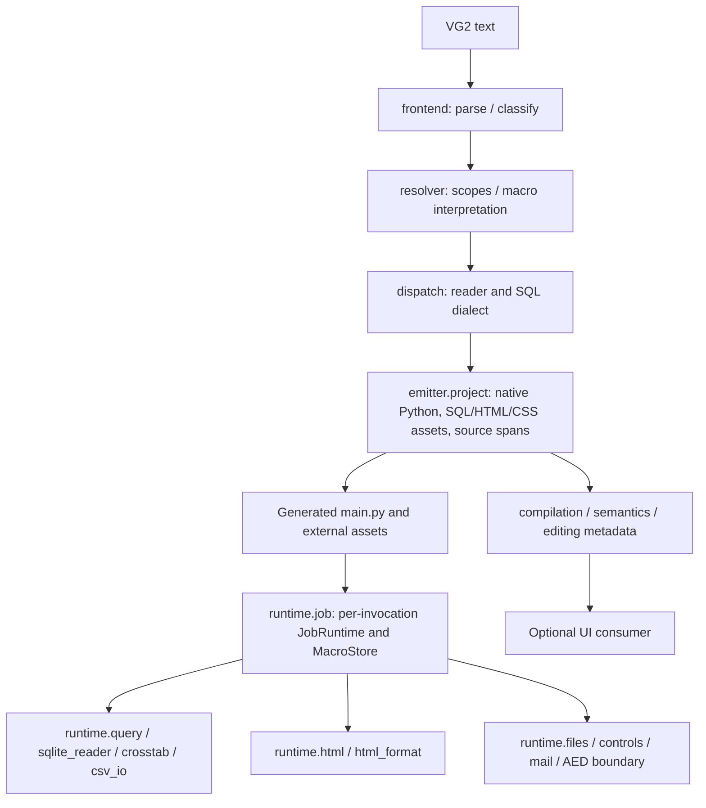

# Independent Post-Session 05 Architecture and ScriptHost Audit

**Repository/branch:** VectorLim/SQLPathFinder_PY_Migration — `refactor/generated-code/implementation`  
**Immutable review entry:** `29b5586c7ec8a5768c60751774b6aca122007058` (verified identical to remote HEAD at entry)  
**Review date:** 2026-10-11  
**Disposition:** **Conditionally ready for further integration and environment-specific validation; not production-certified.** The offline core has a corrected and CI-tested SQLite failure-handling defect. The full suite retains the same six inherited UI/JMP failures. Original ScriptHost execution and proprietary infrastructure have not been tested.

## 1. Executive technical assessment

The supported direct-generated-project architecture has defensible ownership: source interpretation resides in the compiler, Python and editable assets are emitted centrally, and installed `vg2c.runtime` executes those assets without importing compiler modules. Generated code has native Python control flow and a per-invocation `JobRuntime` and `MacroStore`; SQL, HTML and CSS are independently editable. The original ScriptHost is the semantic reference; historical vg2c behavior is not.

**Confirmed high-severity defect fixed:** `runtime/sqlite_reader.py::_SqliteReader.execute` caught and ignored every `sqlite3.Error` for statements before the final statement. This could produce apparently successful CSV output despite a failed INSERT or malformed setup statement. Two initially failing tests reproduced the bug on GitHub Actions; the smallest correction now propagates an attributed `RuntimeError`. The original ScriptHost's Python SQLite path propagates query errors (`SPFUtilities/memtable.py:2392–2434`; `SPFSQL3.py:7205–7207,7247–7250`). Thus silently ignoring those failures was not source-faithful.

**Proven obsolete path removed:** `emitter/walker.py` was a second, disconnected emitter invoking `UtilitySpec.dispatch_and_emit`, which the current `UtilitySpec` no longer defines. The active compiler uses `emitter.emit() → project.emit_project()`. Principal compiler/import/test call sites were reviewed without finding a consumer. This is removal of a broken historical path, not a new emitter abstraction.

The independent review used GitHub source and clean GitHub Actions runners. **No local Git checkout/worktree, locally executed tests, original ScriptHost engine, or proprietary DataSyncX/Oracle/AED system were available.** This audit does not certify exhaustiveness of all dynamic imports, workflows or service integrations.

## 2. Architectural dependency and responsibility map

| Layer | Authoritative files | Contract and assessment |
| --- | --- | --- |
| Orchestration | `compilation.py`, `frontend/*`, `resolver/*`, `dispatch/*` | Single parse/classify/resolve/dispatch pipeline. Keep compiler interpretation outside installed runtime. |
| Utility classification and metadata | `utilities/_base.py`, `utilities/{macro_control,direct_operations,html_report,sqlite_engine,fs_ops,...}.py`, `utility_metadata.py` | Retain registered handlers, `@emittable` source/edit IDs and file effects. Some methods are metadata stubs, **not** rival runtime engines. |
| Emission | `emitter/project.py`, `emitter/models.py`, `emitter/indent_writer.py` | One direct-project emitter. A ~582-line orchestrator is worth targeted future decomposition only if responsibility or correctness evidence warrants it; avoid speculative factories/managers. |
| Editable metadata | `semantics.py`, `editing.py`, `workflow.py`, `dataflow/file_effects.py` | Compiler-side source spans and workflow/file effects serve real consumers; not safe to remove merely because they are not runtime imports. |
| Job lifetime | `runtime/job.py`, `runtime/macros.py`, `runtime/values.py` | Fresh job state; distinct project asset and output roots; scoped macro frames; one substitution authority. |
| SQL and files | `runtime/{query,sqlite_reader,crosstab,csv_io,sql_text,files,controls}.py` | Executable transformations, SQL routing, outputs, loops. Prior silent SQLite error suppression was corrected. |
| Reports | `runtime/{html,html_format}.py` | One HTML-first renderer with editable markup and CSS; no second stateful legacy HtmlReport renderer. |
| Deployment | `pyproject.toml`, `tests/deployment/verify_linux_wheel.py`, `.github/workflows/session05-installed-linux.yml` | Installed-wheel detached execution for the offline supported subset, not a production container certification. |

**Dependency direction:** runtime imports runtime modules and external dependencies, not compiler/emitter/frontend modules. Tests specifically check runtime import isolation. Compiler metadata may import runtime algorithms for concrete utility wrappers; this is a compiler-to-runtime direction, not a runtime-to-compiler dependency. `ctx` in operation IDs is historical compiler metadata identity; no generated `PipelineContext` remains.

## 3. Original ScriptHost semantic compliance matrix

Evidence levels: **SOURCE-OBSERVED** = direct original source inspection; **SOURCE-DERIVED** = expectations reconstructed from original code and tested against the new implementation; **INTENTIONAL-FIX** = justified modern difference; **UNVERIFIED** = no sufficient evidence of complete parity; **UNSUPPORTED** = excluded feature. **ENGINE-VERIFIED: none in this review.** A passing vg2c test is not original-engine differential verification.

| Functional area | Original ScriptHost source and source-observable behavior | Current implementation and test evidence | Assessment / disposition |
| --- | --- | --- | --- |
| Macro values and reserved tokens | `SPFGlobals.py:453–502`, `utils.py:1606–1739,2052–2066`: global/environment substitution rules and special tokens | `runtime/values.py`, `runtime/macros.py`; `test_scoped_macros.py`, `test_placeholder_substitution.py` | **SOURCE-DERIVED** major behavior; strict missing ordinary macros, reserved-token handling and scoped overlays covered. No original-engine differential. |
| START-MACRO / nested scopes | `SPFSQL3.py:12491–12515`: file-backed macro initialization; original first-row handling | `JobRuntime.read_macro_row`; `MacroStore.scope()` restores frames; `test_control_parity.py`, `test_job_runtime.py` | **SOURCE-DERIVED** major contracts verified in runtime tests. Unknown peripheral ScriptHost scope interactions **UNVERIFIED**. |
| IF/ELSE, FOR/SITE/RUN | `SPFSQL3.py:12608–13039`: loop values, boundaries and special counters | `emitter/project.py::control_header` / native `if`, `for` and `with`; `runtime/controls.py`; `test_control_parity.py`, `test_macro_store_project.py` | **SOURCE-DERIVED** targeted control parity; compiled native Python retains readable ordering. Unusual engine-only control exceptions **UNVERIFIED**. |
| Runtime globals / substitution | `SPFGlobals.py`, `utils.py` cited above | Fresh `snapshot_values()` per job, `macros.substitute()`; source/edit metadata regressions | **SOURCE-DERIVED**; clock/environment-dependent exact engine output **UNVERIFIED**. |
| SQL readers and parameters | `SPFSQL3.py:6846–7250` (`nqSQLiteTask`); `memtable.py:1702–2553` (`Run_SQLite`). SQLite query errors propagate from original Python execution | `runtime/query.py`, `runtime/sqlite_reader.py`; `test_direct_runtime.py`, `test_table_semantics_session03.py`, new `test_sqlite_statement_failures.py` | **SOURCE-OBSERVED** error propagation; **CONFIRMED BUG FIXED**: no longer swallow failed setup statements. SQLite binds/joins covered. Proprietary external readers **UNVERIFIED**. |
| CSV table loading / output headers | Original `memtable.py::Run_SQLite` supports imported delimited tables, multiple CSV/header options | `runtime/sqlite_reader.py`, `runtime/csv_io.py`; duplicate labels, bindings, renamed headers and downstream queries tested | **SOURCE-DERIVED** common offline behavior; full encoding, delimiters, `MyEmptyNull`, `QUOTECSV`, no-header and large-file parity **UNVERIFIED**. |
| Crosstab FIRST/LAST and chunking | `utils.py:3991–4512` `PivotTable`/`pivotDF`: inferred row grouping, 50,000 rows at ScriptHost entry, positional duplicate selection per chunk and `combine_first()` across overlapping chunks | `runtime/crosstab.py::apply`; `test_crosstab_corrective_pass.py`, `test_crosstab_script_host_parity.py` cover duplicate order, string IDs, 50k boundaries and missing values | **SOURCE-OBSERVED / SOURCE-DERIVED** key behavior. **INTENTIONAL-FIX:** normalize mixed-case pivot identities and reject header collisions instead of reproducing source ambiguity. Standalone-mode 1m chunk default **UNVERIFIED/unsupported signal**. |
| CTARRAY and downstream SQL | `utils.py:4514–4549` `Save_CT_Header`; `SPFSQL3.py:4509–4777` `SubStitute_CT` | `runtime/crosstab.py` header-list artifact and query-time rewrites; `test_crosstab_sql_rewrites.py`, `test_crosstab_corrective_pass.py` | **SOURCE-DERIVED** covered for supported SQL tokens, source-order CSV output and header lists. Exotic expressions **UNVERIFIED**. |
| SQL_Get_CSV_List | `SPFSQL3.py:2984–3140` substitutes CSV list values into SQL and applies original special-case formatting | `runtime/sql_text.py` scanner plus `runtime/csv_io.py::sql_get_csv_list`; existing tests for quote escaping and list deduplication | **SOURCE-DERIVED** common cases; source-specific exotic aliases/remote systems **UNVERIFIED**. |
| File paths and external operations | ScriptHost file operations run relative to its job/work roots and utilities | `runtime/files.py`, `runtime/controls.py`, `JobRuntime.asset_path()`; `test_job_runtime.py`, `test_runtime_path_ownership_session05.py` | **SOURCE-DERIVED** for portable root handling. Absolute paths, filesystem side effects and legacy command variants require targeted tests before claiming full parity. |
| HTML-RUN CSS and report | `SPFSQL3.py:20048–20120`, `utils.py:8866–9274`: CSS generation and immediate HTML reporting | `runtime/html.py`, `runtime/html_format.py`, per-job CSS publish; `test_html_assets_session04.py`, `test_direct_html.py` | **SOURCE-OBSERVED** lifecycle; **INTENTIONAL-FIX** HTML-first tables/CSS assets, safe HTML escaping. Complete formatter fidelity **UNVERIFIED**. |
| Dynamic HTML columns and patterns | `utils.py:9324–9539`: patterns depend on current input CSV schema; field/header/alignment roles distinct | Editable marked `<table data-report>`, `data-field`, `data-pattern`, one runtime renderer; `test_html_corrective_session04.py` | **SOURCE-DERIVED** runtime expansion; safe bounded patterns **INTENTIONAL-FIX**. Advanced `COLUMN-FORMAT` **UNVERIFIED/UNSUPPORTED**. |
| HTML-DEFER, LAYOUT, DELETE | `SPFSQL3.py:20123–20189,20224–20255`; `utils.py:12004–12704,14003–14125`: defer, assemble referenced reports in layout order; delete referenced artifacts | `JobRuntime.report()`, `html()`, `delete_html()`; exact report IDs/fragments, literal-dollar and placeholder collisions tested | **SOURCE-OBSERVED / SOURCE-DERIVED** supported lifecycle. `HTMI`/`HTMLI5`/`HTMIC`, distributed/interactive delivery **UNSUPPORTED**. |
| Editing/source offsets | Modern translator requirement; not an original ScriptHost execution behavior | `emitter/models.py`, `editing.py`, `semantics.py`; emitter/edit tests inspect exact slices | **TRANSLATOR CONTRACT**, tested; not an engine-parity claim. |

The matrix deliberately differentiates code-path inspection and tests of derived expectations from actual original-engine execution. In particular, this review did **not** run `SPSQL3_py` end-to-end.

## 4. Dead-code and redundancy keep/remove inventory

| Candidate | Decision | Evidence / consequences |
| --- | --- | --- |
| Old `utilities/macro_state.py` | **Already removed Session 05; stay removed** | Runtime `MacroStore` and `values.substitute` are the authoritative macro owner. |
| Old `utilities/pipeline_context.py` | **Already removed Session 05; stay removed** | Generated jobs use `JobRuntime` and canonical runtime query/file operations. |
| Old embedding package | **Already removed Session 05; stay removed** | Native direct-project emitter and installed runtime replace source-code embedding. |
| Stateful old HtmlReport renderer | **Already removed Session 05; stay removed** | `runtime/html.py` renders; `utilities/html_report.py` remains compiler-only metadata/layout parser. |
| `emitter/walker.py` | **Removed in this audit** | Orphaned second emitter called nonexistent `UtilitySpec.dispatch_and_emit`; current entry is `project.emit_project`; no principal compiler/emitter/test reference found. Removed without changing supported direct emitter. |
| `utilities/direct_operations.py` and `macro_control.py` | **Keep** | Required historical operation IDs, editor capability metadata and native-control compilation, not executable alternate engines. |
| `utilities/python_embed.py` | **Keep** | Classifier for supported authored Python block; current project emitter embeds native body. Not evidence of resurrected old embedding framework. |
| `utilities/csv_io.py` and utility wrappers | **Keep** | Annotated/compiler metadata delegates to runtime; wrapper alone is not duplicate algorithm ownership. |
| `runtime/job.py::report_spec`, legacy `.header.json`/`.crosstab.json` adapters | **Keep pending consumer migration** | Earlier generated assets and tests exercise these compatibility readers; only one runtime renderer/pivot algorithm exists. Never add new `.report.json` emission. |
| `emitter/globals.py` and old SQL literal helpers | **Investigate before removal** | Existing `tests/emitter/test_globals.py` and utility methods still exercise semantic extraction; no proof that every entry is safe to remove. |
| `runtime/sqlite_reader.py` setup statement suppression | **Remove faulty behavior; preserve module** | Source-backed defect and failing regression cases; repaired in place. |

**Audit limitation:** A targeted import/reference review and supported test runs were used, not a complete whole-repository static call graph or runtime instrumentation of every optional UI/third-party integration. Thus no blanket statement that every dynamically referenced helper is proven live/dead is made. No test was deleted in this review.

## 5. Findings and exact corrections

### HIGH — silently ignored SQLite setup errors (fixed)

- **File/function:** `src/vg2c/runtime/sqlite_reader.py::_SqliteReader.execute`.
- **Root cause:** non-final statements used `except sqlite3.Error: pass`. Data mutation failures did not interrupt the job.
- **Source authority:** `scripthost-utilities-decompiled/SPSQL3_py/SPFLib/SPFUtilities/memtable.py:2392–2434`: `curObj.execute` / `executescript` inside re-raising error handler; `SPFSQL3.py:7205–7207,7247–7250` propagates the error.
- **Correction:** raise `RuntimeError` preserving original SQLite error and SQL statement as diagnostic context; existing final query error behavior unchanged.
- **Test first:** `04d064261ce874349c3acf91348f5e18c29b3309`, two new reproductions failed as expected: [red runtime CI](https://github.com/VectorLim/SQLPathFinder_PY_Migration/actions/runs/38136878474) (402 other runtime/emitter passes; two new failures). Added valid multi-statement positive case too.
- **Correction:** `e013bf0da1ea8b508c1943b1b2e0aaf5d57237a5`: [runtime/full CI](https://github.com/VectorLim/SQLPathFinder_PY_Migration/actions/runs/38136947307) 172 focused passed; 404 runtime/emitter passed; full 582 passed and the same six inherited UI/JMP failed; [installed-wheel CI](https://github.com/VectorLim/SQLPathFinder_PY_Migration/actions/runs/38136947314) passed.

### MEDIUM — obsolete alternative emission path (removed)

- **File/function:** `src/vg2c/emitter/walker.py::walk_and_emit`.
- **Root cause:** invoked removed `UtilitySpec.dispatch_and_emit` and represented a pre-direct-emitter architecture.
- **Risk:** misleading maintenance entry point and dead executable code that would fail if called.
- **Correction:** delete the file, keep `emitter.emit() → project.emit_project()`. Principal compiler and relevant test references were checked. Regression gate: existing emitter tests and Linux wheel; no test count inflated by removing tests.
- **Limitation:** external clients explicitly importing the private `vg2c.emitter.walker` module were not identified; this internal path was not a supported generated-project contract.

### Further findings / prioritized risks

- **MEDIUM, UNVERIFIED:** `_SqliteReader._load_csv_as_table` reads all rows eagerly (`rows = list(reader)`), increasing memory for very large CSV imports; it skips rows equal to the header, likely for repeated-header concatenations but potentially matching real data. Do not alter until original `MemTable.Run_SQLite` data/header behavior and large-file constraints are examined with fixtures.
- **MEDIUM, UNVERIFIED:** `runtime.files.copy_file` accepts `recurse` but currently uses `copytree` for any directory regardless of the flag. Clarify the actual supported ScriptHost `SPFCopy`/`RoboCopy` contract before altering this behavior.
- **MEDIUM, UNVERIFIED:** regex-driven SQL alias/projection substitutions operate on recognized narrow SQL forms, not full arbitrary SQL grammar. Add adversarial quoted-identifier, alias and whitespace tests before broadening syntax.
- **MEDIUM, UNVERIFIED:** ScriptHost SQL/CSV encoding, null typing, quoting, no-header, preprocessed imports and target proprietary readers are not proven equivalent in all combinations.
- **LOW/MAINTAINABILITY:** older comments in compiler utility modules and the large but cohesive `emitter/models.py`, `emitter/project.py`, `semantics.py`, `editing.py` should be updated/decomposed only when a verified ownership or maintenance need arises. Additional manager/facade layers are not justified now.
- **KNOWN OUT OF SCOPE:** six UI/JMP failures and unsupported report/interactivity and HPC/JMP/JSL utility families.

## 6. Test-deletion coverage audit

Session 05 removed tests that asserted old `MacroState`, source embedding, topology and stateful HTML preview internals. Its handoff identifies the deleted files (`tests/runtime/test_macro_state.py`, `tests/emitter/test_symbol_resolution.py`, `tests/emitter/test_topo_sort.py`) and modern behavioral replacements. In particular, valid `CrossTab->[[...]]` SQL rewrite assertions were retained under `tests/runtime/test_crosstab_sql_rewrites.py`; source offsets/control/metadata tests and the independent installed-wheel execution probe cover the current design.

**No tests were weakened or deleted by this review.** The new SQLite file has two negative cases and one positive case. Passing count changes therefore reflect added tests, not a deleted failing assertion. Original deleted-test-to-new-test equivalence has been checked against the Session 05 removal inventory and representative tests; a byte-by-byte full semantic audit of every historical test is **not claimed**.

## 7. Validation performed and precise limitations

All commands below were executed in **GitHub Actions clean Linux runners**, not in this conversation's local container. The runtime/full-suite results were inspected from actual workflow job logs at the code-fix commit `e013bf0da1ea8b508c1943b1b2e0aaf5d57237a5`.

| Gate | Command / workflow | Observed result |
| --- | --- | --- |
| Source compilation | `python -m compileall -q src` | Pass |
| Scoped static check | `ruff check --select F821,F823 src/vg2c/runtime src/vg2c/emitter src/vg2c/utilities` | Pass (not full-tree Ruff coverage) |
| Session focused suite | Session 03 workflow focused `python -m pytest -q` selection | **172 passed** |
| Runtime/emitter | `python -m pytest -q tests/runtime tests/emitter` | **404 passed** |
| Full repository | `python -m pytest -q` | **582 passed, six inherited UI/JMP failures** |
| Offline detached Linux wheel | `.github/workflows/session05-installed-linux.yml`, `tests/deployment/verify_linux_wheel.py` | **Success** |
| Static source review | GitHub checked-out branch source and original ScriptHost decompiled files | SOURCE-OBSERVED portions above; no proprietary engine execution |

Later review-only commits remove the broken walker, simplify a test assertion and add this audit document. Their exact final SHA and CI should be checked independently; a documentation commit cannot self-record its own SHA. **For final exact-head results, use GitHub Actions triggered by the final push**; do not assume a prior SHA's successful workflow proves a subsequent SHA.

**Inherited full-suite failures** (unchanged and unsuppressed): `tests/ui/test_document_store.py` shared-global-edit persistence, reorder persistence and obsolete HtmlReport preview; `tests/ui/test_html_preview.py` unsupported JMP/JSL preview; `tests/ui/test_workspace_sessions.py` CSV column choices and file-backed SQL filter-save/generate. See Session 05 handoff for exact test names.

**Deployment scope:** Python 3.12; synthetic offline SQLite / crosstab / CTARRAY / SQL, HTML, CSS editability, distinct workdir, package import isolation. Installed wheel intentionally uses `--no-deps` plus pandas for this bounded offline probe. Not certified: real Intel network, DataSyncX, Oracle/AED, production container dependencies, credentials, browser/editor UI and original ScriptHost binary/differential parity.

## 8. Generated-code readability

The direct emitter produces native `run()` logic, `JobRuntime(BASE_DIR, workdir)`, straightforward `macros[...] / macros.scope(...)`, `job.sql('sql/...')`, `job.html('html/...')`, and external SQL/HTML/CSS assets. Runtime reads source assets on each execution and keeps workdir data separate from source assets. Existing fixture and deployment tests execute representative projects; the Session 03 workflow checks a compile-only generated ICMPCS source metric against the historical committed reference without executing proprietary production inputs. The emitter's source and representative tests were examined here. **No new manual side-by-side multi-production-job readability benchmark or proprietary generated-job run was performed.**

Preserve visible business options in Python, especially backend reader, SQL binds and pivot choices, rather than hiding them in JSON sidecars or long embedded strings. Avoid a second interpreter, overabstracted execution framework or giant helper that defeats native control flow.

## 9. Final self-review and release readiness

- Review of changed behavior: only SQLite setup error propagation changes execution semantics, in line with the original source; successful multi-statement path remains tested. Failure stops CSV write.
- Review of changed structure: deletion of a disconnected broken internal walker leaves the actual emitter, source metadata, utility registration and runtime imports unchanged.
- Review of tests: explicit red-to-green reproduction plus valid setup/query case; no suppression of inherited UI failures. No new generated SQL/HTML/CSS coupling.
- Limitations still material: no local worktree or original engine differential, third-party integration and production container unverified, full suite still has six inherited UI/JMP failures, targeted—not exhaustive—dynamic reference audit and original ScriptHost utility-family coverage.

**Decision: suitable for further controlled integration and production-environment validation of the supported core, but not for unconditional production release.** Resolve or formally scope the six inherited failures; run representative proprietary ScriptHost-to-translated-output differentials with approved data; validate DataSyncX/Oracle/AED and the actual Linux deployment image; expand original-source parity where identified as unverified. Do not merge, release or certify the production environment solely on this synthetic CI evidence.
